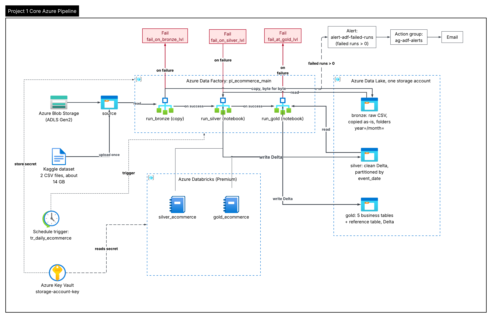

# Core Azure Pipeline project

This project takes a large public dataset of online-store clicks, copies it into a cloud data lake, cleans it, and produces small tables that answer business questions. Everything runs automatically from one pipeline in Azure Data Factory.
Each row in the file represents an event. All events are related to products and users. Each event is like many-to-many relation between products and users.

---

## 1. What the project does

- **Input:** two CSV files with about 110 million click events from October and November 2019 (14 GB). Source: Kaggle, `mkechinov/ecommerce-behavior-data-from-multi-category-store`.
- **Output:** five business tables and one reference table, stored as Delta tables in the data lake, plus a SQL-queryable copy in Databricks.
- **Questions the tables answer:** how traffic changes by hour, how many views turn into purchases, which categories and brands earn the most, and which products are viewed often but rarely bought.

---

## 2. Words used in this project

| Word | Plain meaning |
|---|---|
| **Azure** | Microsoft's cloud. You rent computers and storage from it. |
| **Resource group** | A folder for related Azure resources. Deleting the folder deletes everything in it. |
| **Storage account** | Cloud disk space. Here it is called the data lake. |
| **Container** | A top-level folder inside a storage account. We use four: `source`, `bronze`, `silver`, `gold`. |
| **Data Lake (ADLS Gen2)** | A storage account with real folders, built for analytics. |
| **Data Factory (ADF)** | The conductor. It starts the steps in order and tells you when something fails. |
| **Pipeline** | A list of steps that ADF runs in order. |
| **Activity** | One step in a pipeline (copy, notebook, fail). |
| **Databricks** | A service that runs Spark code, which processes big data quickly. Code is written in notebooks. |
| **Notebook** | A document with code cells that you run one by one. |
| **Cluster** | The computer(s) that run Databricks code. It costs money while it is running. |
| **Delta table** | A table stored as Parquet files plus a log of every change. Safer than plain CSV. |
| **Bronze / silver / gold** | Layers of data: raw copy, cleaned data, business tables. |
| **Key Vault** | A safe place for passwords and keys. Code asks for a secret by name. |
| **Managed identity** | An automatic "user account" that Azure gives a service, so it needs no password. |
| **Trigger** | Something that starts a pipeline: a button you press, or a schedule. |
| **Idempotent** | Running the same job twice gives the same result, with no duplicate rows. |
| **MERGE** | A Delta operation that updates matching rows and inserts new ones. |
| **OPTIMIZE** | A Delta command that joins many small files into fewer large ones. |

---

## 3. The pipeline architecture
 

 
Read the picture from left to right:
 
1. The dataset is uploaded once to the `source` container.
2. **Step 1, `run_bronze`:** Data Factory copies the two files, byte for byte, into `bronze`. Bronze is never changed afterwards.
3. **Step 2, `run_silver`:** a Databricks notebook reads bronze, fixes data types, removes bad and duplicate rows, and writes clean data to `silver`.
4. **Step 3, `run_gold`:** a second notebook reads silver and writes the business tables to `gold`.
5. If a step fails, a red path goes to a **Fail** activity with a clear message, and Azure Monitor sends an email.
6. A schedule trigger, `tr_daily_ecommerce`, can start the whole pipeline once a day.
Where things live:
 
| Thing | Name in this project |
|---|---|
| Resource group | `rg-bigdata-dev` |
| Data lake (storage account) | `stbigdatadev00001` |
| Data Factory | `adf-bigdata-dev-1234` |
| Databricks workspace | `dbw-bigdata-dev-1234` |
| Databricks cluster | `cluster-bigdata-dev` (one node, Standard_D4s_v3, stops after 20 minutes idle) |
| Key Vault | `kv-bigdata-dev-01111` (holds `storage-account-key`) |
| Secret scope in Databricks | `kv-scope` |
| Pipelines | `pl_ingest_bronze` (step 1), `pl_ecommerce_main` (all steps) |
| Notebooks | `silver_ecommerce`, `gold_ecommerce` |
| Published gold tables | `dbw_bigdata_dev_1234.ecommerce` |
 
---

---

## 4. Before you start

You need:

- An Azure subscription where the resources above already exist (or an admin who can recreate them).
- Azure CLI installed and signed in: run `az login`.
- Your user has the role **Storage Blob Data Contributor** on the storage account. Without it you will see `AuthorizationPermissionMismatch`.
- Access to the Databricks workspace and to the cluster.
- A browser to open the Azure portal (`portal.azure.com`).

You do **not** need a password or a storage key in your code. The code reads the key from Key Vault.

---

## 5. How to run the pipeline (step by step)

### Option A: run once by hand

1. Open the Azure portal, search for `adf-bigdata-dev-1234`, click **Launch studio**.
2. In the left menu, click the pencil icon (**Author**). Open `pl_ecommerce_main`.
3. Click **Debug** or **Add trigger → Trigger now**.
4. In the parameter box, check:
   - `load_date`: the date to process, for example `2019-10-01`.
   - `storage_account`: `stbigdatadev00001`.
   - `secret_scope`: `kv-scope`.
5. Click **OK** to start.
6. Open **Monitor** (the gauge icon) → **Pipeline runs**. Wait until the run shows **Succeeded**. A full run takes about 40 to 50 minutes, because the silver step is the longest.

### Option B: run on a schedule

1. In Data Factory, open **Manage → Triggers**.
2. Find `tr_daily_ecommerce`, set it to **Started**, then click **Publish all**.
3. The pipeline now starts once a day. Check **Monitor → Trigger runs** to see each run.

**Important:** a trigger that stays on costs money every day. Stop it when you are not using the project.

### Start the cluster before a demo

1. In Databricks, click **Compute**, then `cluster-bigdata-dev`.
2. Click **Start** and wait about 5 minutes for the status to show green.
3. The cluster stops by itself after 20 minutes without work.

---

## 6. Check the results yourself

You can query the gold tables in a Databricks notebook. Each query is in `sql/queries.sql`. Example:

```sql
SELECT category_group, main_category, SUM(revenue) AS revenue
FROM dbw_bigdata_dev_1234.ecommerce.revenue_by_category_brand
GROUP BY 1, 2
ORDER BY revenue DESC
LIMIT 10;
```

To check that one day was loaded correctly, compare the silver row count with the gold event count for the same date:

```python
silver = spark.read.format("delta").load(
    "abfss://silver@stbigdatadev00001.dfs.core.windows.net/ecommerce_events")
print(silver.filter("event_date = '2019-10-01'").count())   # expect 1241586
```

---

## 7. What was added in Week 4

- **Incremental load.** The pipeline takes `load_date` and processes only that date. Silver uses MERGE, so running the same date twice gives the same result.
- **Reliability.** Each pipeline activity retries twice. The silver notebook checks row counts and stops with an error if they do not match. The gold notebook checks one number against silver.
- **Failure handling.** Each step has its own Fail activity (`fail_on_bronze_lvl`, `fail_on_silver_lvl`, `fail_at_gold_lvl`) with a message that names the step and the date.
- **Alerts.** The alert rule `alert-adf-failed-runs` sends an email when a pipeline run fails.
- **Security.** The storage key is in Key Vault. Data Factory uses a managed identity. No secrets are in the code.
- **Serving.** Gold tables are published in Databricks under `dbw_bigdata_dev_1234.ecommerce` and can be queried by name.

---

## 8. Results

| Measure | Value |
|---|---|
| Rows: raw  | 109 950 743 |
| Rows: rejected  |  256 761 |
| Rows: duplicates removed  | 130 646 |
| Rows: silver | 109 563 336 |
| Full pipeline run | 41 min 48 s |
| Gold step alone | 13 min 31 s |
| Same date run twice (2019-10-01) | 1 241 586 rows both times (no duplicates) |
| OPTIMIZE on silver | 61 partitions checked, nothing needed compacting |

Why OPTIMIZE did nothing: silver was written with `repartition("event_date")` in Week 3, so each date already has one large file.

---

## 9. What it costs

Estimates, from the Azure price pages (East US, pay as you go, checked in November 2026):

| Part | Cost for one full run | Cost per month |
|---|---|---|
| Databricks (VM plus DBUs) | about $0.42 to $0.71 | depends on how long the cluster runs |
| Data Factory | about $0.04 | depends on runs |
| Storage (47.91 GB, Hot) | about $0.03 per day | about $1 |
| Monitor alert rule | $0 (inside the free tier) | $0 |
| Event Hubs | not used in this project | not used |

Actual spend in November was higher than one run. Databricks cost more because the cluster ran longer than the pipeline during development. Stopping the cluster when you finish is the main way to control cost.

---

## 10. Troubleshooting

| What you see | What it means | What to do |
|---|---|---|
| `AuthorizationPermissionMismatch` (403) | Your user or the Data Factory identity lacks a data role | Assign **Storage Blob Data Contributor** on `stbigdatadev00001`, wait 5 minutes, try again |
| `Invalid configuration value detected for fs.azure.account.key` | The storage key was not set in this notebook session | Run the first settings cell of the notebook again, then the cell that needs storage |
| `No data found for <date>` | The date is not in bronze | Use a date inside October or November 2019 |
| `Silver count ... does not match` | Silver and the check disagree | Rerun the silver notebook for that date; if it persists, check the MERGE key |
| `NO_PARENT_EXTERNAL_LOCATION` | Unity Catalog cannot register the path | Use the published tables under `dbw_bigdata_dev_1234.ecommerce` or query by path |
| `UC_HIVE_METASTORE_DISABLED_EXCEPTION` | The legacy `hive_metastore` is switched off | Use Unity Catalog names, as above |
| Pipeline does not appear in a dropdown | It is not published | Click **Publish all**, then refresh the page |
| `Bad credentials` or `Internal Server Error` in Git configuration | Data Factory lost its GitHub authorization | Git → Disconnect, revoke the Azure Data Factory app in GitHub Settings → Applications, reconnect and authorize again |

---

## 11. Clean up (read before you delete anything)

Deleting the resource group deletes everything in it: the data lake, the pipelines, Databricks, Key Vault and the alert. This cannot be undone.

Only do it when:
1. The code is saved in GitHub (notebooks, `adf/`, `sql/`, this README and the diagram).
2. You no longer need the data or the tables.
3. Your instructor or team has seen what they need.

Then run:

```
az group delete -n rg-bigdata-dev --yes
```

Also revoke your Kaggle token in Kaggle **Settings → API**.

---

## 12. Known limits

- Every run loads both bronze files again. The copy step does not filter by `load_date`.
- Databricks reads storage with the account key from Key Vault. Identity-based access would be safer.
- Unity Catalog external locations are not configured, so tables are published as managed tables.
- Data Factory Git integration is set up with the GitHub repository `azure-pipeline`. Publishing in Data Factory saves the pipeline JSON to the repo under `adf/`, so the repo and the live pipeline can drift if someone edits in one place only.

---

## 13. Repository layout

```
azure-pipeline/
  README.md          this guide
  docs/              architecture.png and architecture.dot (the diagram source)
  adf/               Data Factory pipeline definitions (JSON)
  notebooks/         silver_ecommerce and gold_ecommerce (exported)
  sql/queries.sql    business questions and their SQL
```

Never commit files from `data/`, any `.csv` or `.zip` file, or any file with a key or token. The `.gitignore` file already excludes them.
